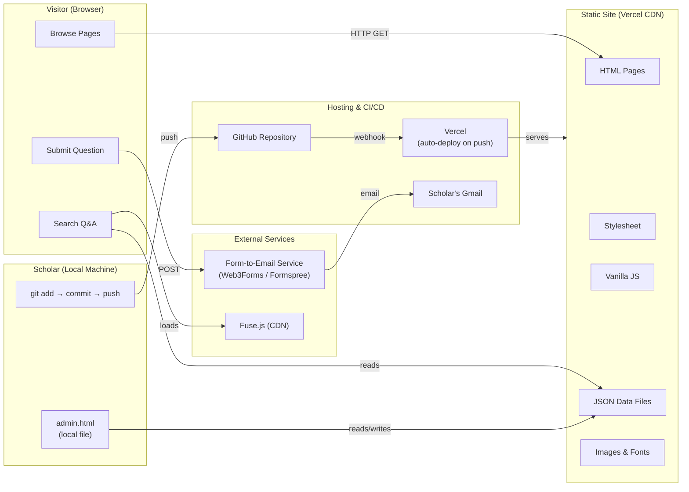
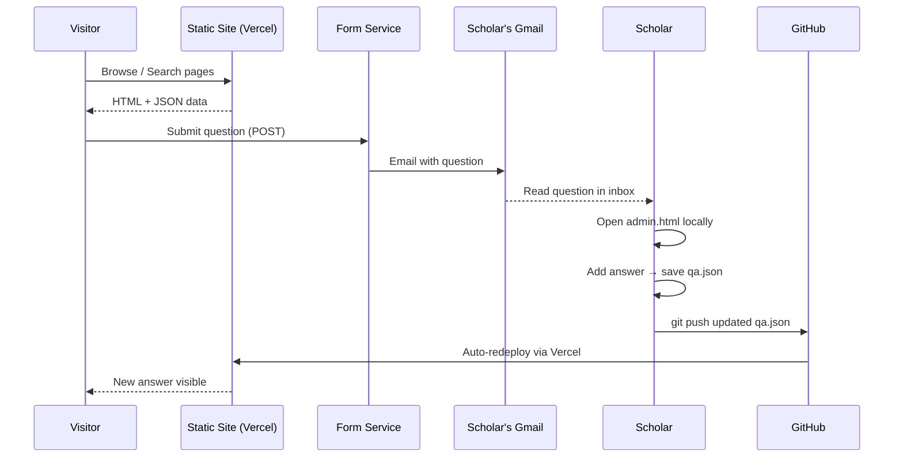
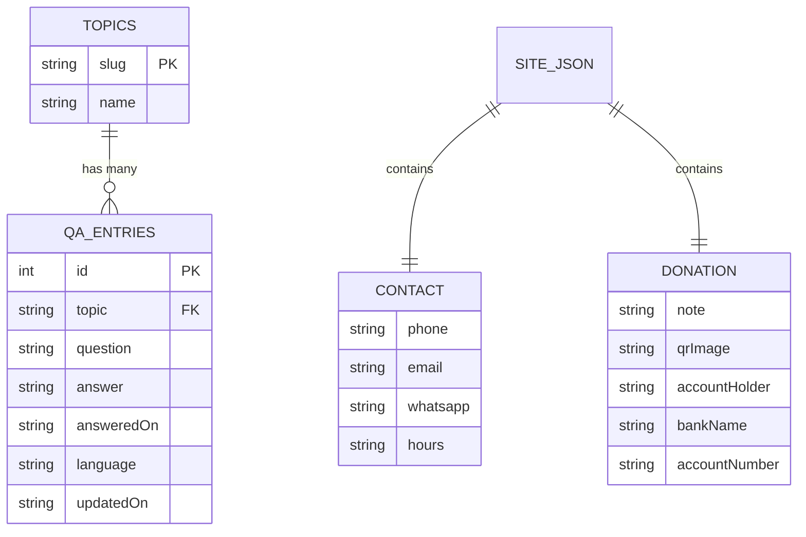
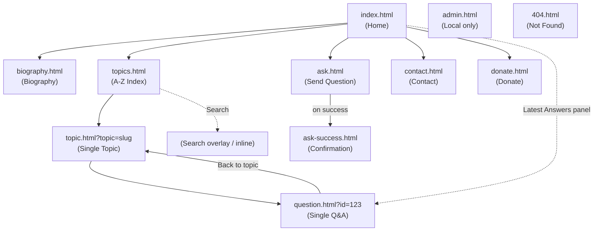
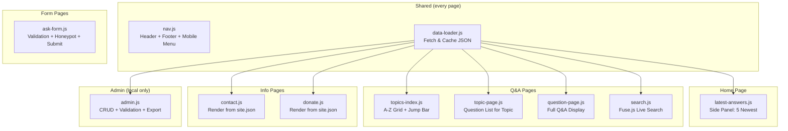
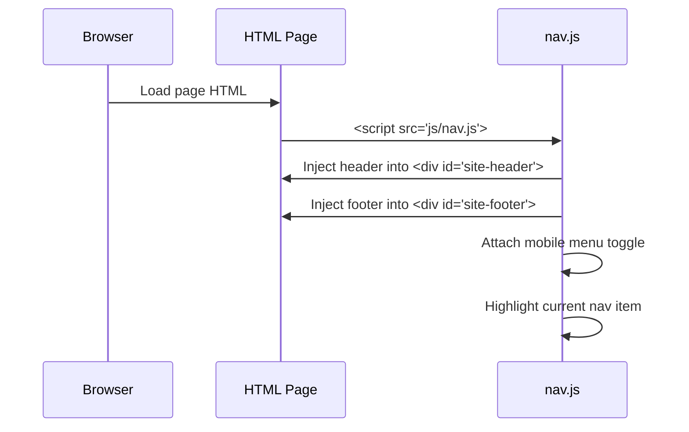
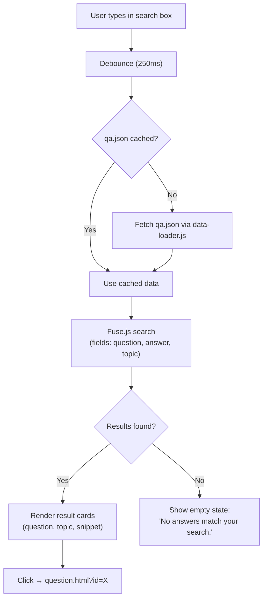
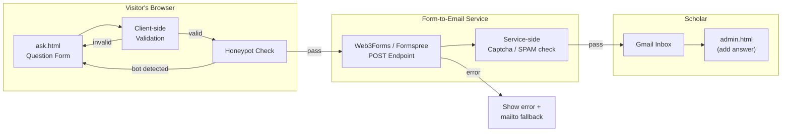
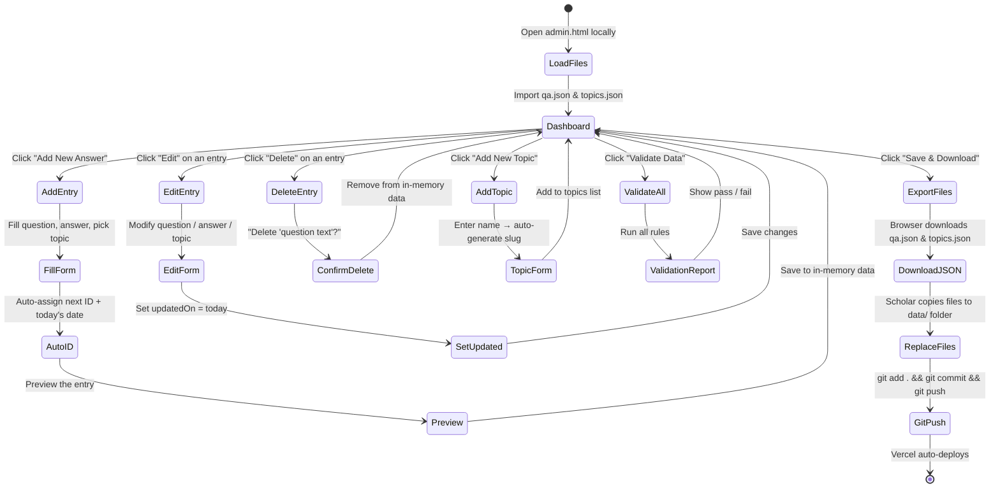
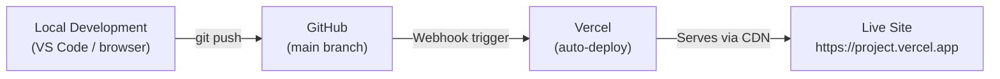

# Scholar Q&A Website — Architecture Document

Nov 7, 2026 · Derived from [Scholar-QA-Website-Problem-Statement.md](./Scholar-QA-Website-Problem-Statement.md)

---

## Table of Contents

1. [Architecture Overview](#1-architecture-overview)
2. [High-Level System Diagram](#2-high-level-system-diagram)
3. [Repository & Folder Structure](#3-repository--folder-structure)
4. [Data Architecture](#4-data-architecture)
5. [Page Architecture & Routing](#5-page-architecture--routing)
6. [Component Architecture](#6-component-architecture)
7. [Shared Layout System](#7-shared-layout-system)
8. [Styling Architecture](#8-styling-architecture)
9. [Client-Side Search Architecture](#9-client-side-search-architecture)
10. [Question Submission Pipeline](#10-question-submission-pipeline)
11. [Admin Workflow Architecture](#11-admin-workflow-architecture)
12. [Deployment Architecture](#12-deployment-architecture)
13. [Security & Privacy Architecture](#13-security--privacy-architecture)
14. [Performance Budget](#14-performance-budget)
15. [Accessibility Architecture](#15-accessibility-architecture)
16. [Error Handling Strategy](#16-error-handling-strategy)
17. [Extensibility & Stretch Goal Hooks](#17-extensibility--stretch-goal-hooks)
18. [Key Architectural Decisions (ADRs)](#18-key-architectural-decisions-adrs)
19. [Dependency Inventory](#19-dependency-inventory)
20. [Development & Build Workflow](#20-development--build-workflow)

---

## 1. Architecture Overview

The Scholar Q&A Website is a **zero-backend, static-file** website. Every page is plain HTML served as-is from a CDN. There is no server-side code, no database server, and no build step. Data is stored in three JSON files committed to the repository and read by the browser at runtime.

### Core Principles

| Principle | What It Means Here |
|---|---|
| **Static-only** | Every file served as-is; no Node.js, no SSR, no build pipeline |
| **Data-driven pages** | All content comes from JSON files; pages render with vanilla JS |
| **Zero cost** | Free GitHub repo + free Vercel Hobby plan; no paid services |
| **Scholar-maintainable** | One non-technical person can add/edit/delete content with written steps |
| **Content integrity** | AI and code never author religious answers; every answer is the scholar's own words |
| **Privacy first** | No cookies, no analytics, no user accounts; asker identity stays in Gmail only |

---

## 2. High-Level System Diagram



### Data Flow Summary



---

## 3. Repository & Folder Structure

```
islamic-qa-website/
│
├── index.html                  # Home page
├── biography.html              # Scholar biography
├── topics.html                 # A-Z topic index
├── topic.html                  # Single topic page (query param: ?topic=slug)
├── question.html               # Single Q&A page (query param: ?id=123)
├── ask.html                    # Send a Question form
├── ask-success.html            # Form submission confirmation
├── contact.html                # Contact details
├── donate.html                 # Donation page
├── search.html                 # Dedicated search results page (optional)
├── admin.html                  # Local admin tool (not linked from nav)
├── 404.html                    # Friendly not-found / deleted-answer page
│
├── css/
│   ├── variables.css           # Design tokens (colours, fonts, spacing)
│   ├── reset.css               # Minimal CSS reset
│   ├── layout.css              # Header, footer, nav, grid, containers
│   ├── components.css          # Cards, badges, buttons, forms, panels
│   ├── pages.css               # Page-specific overrides
│   ├── admin.css               # Admin-only styles
│   └── responsive.css          # Breakpoint-based media queries
│
├── js/
│   ├── data-loader.js          # Fetch and cache JSON data files
│   ├── nav.js                  # Shared header/footer injection, mobile menu
│   ├── topics-index.js         # A-Z index builder with jump bar & counts
│   ├── topic-page.js           # Render questions for a single topic
│   ├── question-page.js        # Render a single Q&A entry
│   ├── search.js               # Fuse.js integration, live results
│   ├── latest-answers.js       # Home page "Latest Answers" side panel
│   ├── ask-form.js             # Form validation, honeypot, submission
│   ├── contact.js              # Render contact details from site.json
│   ├── donate.js               # Render donation details from site.json
│   ├── admin.js                # Admin CRUD, file import/export, validation
│   └── utils.js                # Date formatting, slug helpers, URL params
│
├── data/
│   ├── qa.json                 # All published Q&A entries
│   ├── topics.json             # Topic list (slug + display name)
│   └── site.json               # Contact info, donation details, site meta
│
├── assets/
│   ├── images/
│   │   ├── scholar-photo.jpg   # Scholar's professional photo
│   │   ├── qr-code.png         # Donation QR code (supplied by scholar)
│   │   └── favicon.png         # Site favicon
│   └── fonts/                  # Self-hosted web fonts (if any)
│
├── validate.html               # Data validation checker page
├── .gitignore
├── README.md
├── vercel.json                 # Vercel routing config (rewrites, 404)
└── LICENSE                     # Optional
```

### Key Structural Decisions

- **No nested routes** — all HTML files live at the root. Dynamic content is driven by query parameters (`?topic=slug`, `?id=123`), not file paths. This avoids rewrite complexity on a static host.
- **`admin.html` is in the repo but not linked** — it is accessible only to someone who clones the repo and opens it locally via `file://`.
- **`data/` is the single source of truth** — every content change is a JSON edit, committed and pushed.

---

## 4. Data Architecture

### 4.1 `data/qa.json`

An array of Q&A entry objects, ordered by `id` (ascending). The newest entries have the highest IDs.

```json
[
  {
    "id": 1,
    "topic": "prayer",
    "question": "Is it permissible to combine Dhuhr and Asr prayers?",
    "answer": "Yes, it is permissible to combine ...",
    "answeredOn": "2026-10-15",
    "language": "en",
    "updatedOn": ""
  }
]
```

| Field | Type | Constraints |
|---|---|---|
| `id` | `number` | Unique, positive integer, never reused after deletion |
| `topic` | `string` | Must match a `slug` in `topics.json` |
| `question` | `string` | Non-empty, trimmed |
| `answer` | `string` | Non-empty; may contain line breaks for paragraphs |
| `answeredOn` | `string` | `YYYY-MM-DD` format |
| `language` | `string` | `"en"` for v1 |
| `updatedOn` | `string` | `YYYY-MM-DD` or empty string if never edited |

**ID strategy:** Auto-incremented integer. `admin.html` reads the current max ID and assigns `max + 1`. IDs are never reused — if entry 42 is deleted, the next new entry is still max + 1 (not 42 again). This ensures permanent links remain stable.

**Permanent link format:** `/question.html?id=123` — the ID is the sole anchor. Renaming a topic or editing the question text does not break the URL.

### 4.2 `data/topics.json`

An array of topic objects, kept in alphabetical order by `name`.

```json
[
  { "slug": "business", "name": "Business" },
  { "slug": "fasting", "name": "Fasting" },
  { "slug": "prayer", "name": "Prayer" }
]
```

| Field | Type | Constraints |
|---|---|---|
| `slug` | `string` | Lowercase, URL-safe (`[a-z0-9-]`), unique |
| `name` | `string` | Display name; first character drives A-Z index grouping |

**Slug generation:** `admin.html` auto-generates the slug from the name (lowercase, spaces → hyphens, strip non-alphanumeric). The scholar can override it.

### 4.3 `data/site.json`

A single object with two top-level keys: `contact` and `donation`.

```json
{
  "siteName": "Ayatullah Syed Sibtain Abbas Rizvi",
  "tagline": "Questions & Answers on Islamic Jurisprudence",
  "contact": {
    "phone": "+91-XXXXXXXXXX",
    "email": "scholar@example.com",
    "whatsapp": "https://wa.me/91XXXXXXXXXX",
    "addresses": [
      { "label": "Qum, Iran", "lines": ["..."] },
      { "label": "India", "lines": ["..."] }
    ],
    "hours": "Saturday to Thursday, 10 AM – 1 PM (Iran time)",
    "social": [
      { "platform": "YouTube", "url": "https://..." },
      { "platform": "Telegram", "url": "https://..." }
    ]
  },
  "donation": {
    "note": "Donations support the scholar's educational and religious activities.",
    "qrImage": "assets/images/qr-code.png",
    "bankDetails": {
      "accountHolder": "...",
      "bankName": "...",
      "accountNumber": "...",
      "branch": "...",
      "ifsc": "..."
    }
  }
}
```

**Rendering rule:** Any field that is `""`, `null`, or an empty array is silently omitted from the page — no blank labels or empty boxes.

### 4.4 Data Relationships



### 4.5 Validation Rules

These are enforced by `admin.html` before export and by `validate.html` as a standalone check:

| Rule | Error Message |
|---|---|
| Every `qa.json` entry has a non-empty `id`, `topic`, `question`, `answer`, `answeredOn` | "Entry {id}: missing required field {field}" |
| Every `topic` value in `qa.json` exists as a `slug` in `topics.json` | "Entry {id}: topic '{topic}' not found in topics.json" |
| No two entries share the same `id` | "Duplicate ID: {id}" |
| `answeredOn` and `updatedOn` match `YYYY-MM-DD` | "Entry {id}: invalid date format in {field}" |
| Every `slug` in `topics.json` is unique and URL-safe | "Duplicate or invalid topic slug: {slug}" |
| `site.json` has `contact.phone` and `donation.bankDetails` at minimum | "site.json: missing required contact/donation fields" |

---

## 5. Page Architecture & Routing

Since there is no build step and no server-side routing, navigation uses plain HTML files and query parameters.

### 5.1 Page Map



### 5.2 URL Scheme

| Page | URL | Parameters |
|---|---|---|
| Home | `/` or `/index.html` | — |
| Biography | `/biography.html` | — |
| Topics Index | `/topics.html` | — |
| Single Topic | `/topic.html` | `?topic={slug}` |
| Single Question | `/question.html` | `?id={number}` |
| Ask a Question | `/ask.html` | — |
| Confirmation | `/ask-success.html` | — |
| Contact | `/contact.html` | — |
| Donate | `/donate.html` | — |
| Admin (local) | `/admin.html` | — |
| Not Found | `/404.html` | — |

### 5.3 Vercel Routing (`vercel.json`)

```json
{
  "cleanUrls": true,
  "trailingSlash": false,
  "routes": [
    { "handle": "filesystem" },
    { "src": "/(.*)", "dest": "/404.html", "status": 404 }
  ]
}
```

With `cleanUrls: true`, Vercel serves `/biography` from `biography.html`, giving cleaner URLs without manual rewrites.

---

## 6. Component Architecture

Although there is no framework, the JS is organized into logical "components" — self-contained modules that own a DOM region.

### 6.1 Component Map



### 6.2 `data-loader.js` — Central Data Layer

This module handles all JSON fetching and provides a simple caching layer so multiple components on the same page don't re-fetch.

```
DataLoader
├── loadQA()        → Promise<Array>   (fetches & caches data/qa.json)
├── loadTopics()    → Promise<Array>   (fetches & caches data/topics.json)
├── loadSiteInfo()  → Promise<Object>  (fetches & caches data/site.json)
└── clearCache()    → void             (for admin page refresh)
```

**Caching strategy:** Simple in-memory variable per file. Once fetched, the promise result is stored. No localStorage, no service workers in v1. The data files are small (< 100 KB even with hundreds of entries) so the network cost is trivial.

**Base path handling:** `data-loader.js` detects whether it is running from a `file://` URL (admin use) or an `https://` URL (production) and adjusts the fetch path accordingly.

### 6.3 `utils.js` — Shared Utilities

```
Utils
├── getParam(name)              → string | null   (read URL query parameter)
├── formatDate(dateStr)         → string           ("15 October 2026")
├── slugify(text)               → string           ("Prayer Rules" → "prayer-rules")
├── escapeHTML(text)            → string           (prevent XSS in dynamic content)
├── isRecent(dateStr, days=7)   → boolean          (for "New" badge logic)
├── truncate(text, maxLen)      → string           (for previews)
└── copyToClipboard(text)       → Promise<void>    (for donation "copy" buttons)
```

---

## 7. Shared Layout System

Every page includes the same header, navigation, and footer. Since there is no templating engine, this is done by JS injection.

### 7.1 Layout Injection Flow



### 7.2 HTML Page Template

Every page follows this skeleton:

```html
<!DOCTYPE html>
<html lang="en" dir="ltr">
<head>
    <meta charset="UTF-8">
    <meta name="viewport" content="width=device-width, initial-scale=1.0">
    <title>Page Title — Ayatullah Syed Sibtain Abbas Rizvi</title>
    <meta name="description" content="...">
    <link rel="icon" href="assets/images/favicon.png">
    <link rel="stylesheet" href="css/variables.css">
    <link rel="stylesheet" href="css/reset.css">
    <link rel="stylesheet" href="css/layout.css">
    <link rel="stylesheet" href="css/components.css">
    <link rel="stylesheet" href="css/pages.css">
    <link rel="stylesheet" href="css/responsive.css">
</head>
<body>
    <div id="site-header"></div>

    <main class="container" id="main-content">
        <!-- Page-specific content / mounting points -->
    </main>

    <div id="site-footer"></div>

    <script src="js/utils.js"></script>
    <script src="js/data-loader.js"></script>
    <script src="js/nav.js"></script>
    <!-- Page-specific script(s) -->
</body>
</html>
```

### 7.3 Navigation Items

| Label | Destination | Always Visible |
|---|---|---|
| Home | `index.html` | Yes |
| Biography | `biography.html` | Yes |
| Q&A | `topics.html` | Yes |
| Ask a Question | `ask.html` | Yes |
| Contact | `contact.html` | Yes |
| Donate | `donate.html` | Yes |

The footer includes: contact details summary (phone, email), copyright line, and "Powered by" link to the scholar's name.

---

## 8. Styling Architecture

### 8.1 Design Token System (`variables.css`)

```css
:root {
    /* Colour palette — Islamic green + warm neutrals */
    --color-primary:        #1B5E20;   /* Deep green */
    --color-primary-light:  #388E3C;
    --color-primary-dark:   #0D3B13;
    --color-accent:         #C8A951;   /* Gold accent */
    --color-bg:             #FAFAF5;   /* Off-white */
    --color-bg-alt:         #F0EDE4;   /* Subtle warm grey */
    --color-text:           #2C2C2C;
    --color-text-muted:     #6B6B6B;
    --color-border:         #D5D0C4;
    --color-error:          #B71C1C;
    --color-success:        #2E7D32;

    /* Typography */
    --font-body:            'Inter', 'Segoe UI', sans-serif;
    --font-heading:         'Playfair Display', Georgia, serif;
    --font-arabic:          'Noto Naskh Arabic', 'Amiri', serif; /* RTL stretch */

    /* Spacing scale (4px base) */
    --space-xs:   4px;
    --space-sm:   8px;
    --space-md:   16px;
    --space-lg:   24px;
    --space-xl:   32px;
    --space-2xl:  48px;
    --space-3xl:  64px;

    /* Layout */
    --container-max:   1120px;
    --sidebar-width:   320px;
    --border-radius:   6px;
}
```

### 8.2 Responsive Breakpoints (`responsive.css`)

| Breakpoint | Target | Layout Change |
|---|---|---|
| Default (≤ 599px) | Phones | Single column, stacked layout, hamburger menu |
| `min-width: 600px` | Large phones / small tablets | Slightly wider margins |
| `min-width: 768px` | Tablets | Two-column Q&A topic grid |
| `min-width: 1024px` | Desktops | Side panel beside main content, full nav bar |

**Mobile-first approach:** Base styles target 360px. Media queries add complexity for larger screens.

### 8.3 CSS File Responsibilities

| File | Scope |
|---|---|
| `variables.css` | Custom properties only, no selectors |
| `reset.css` | Box-sizing, margin/padding reset, base font |
| `layout.css` | `.container`, `.grid`, `#site-header`, `#site-footer`, `.sidebar-layout` |
| `components.css` | `.card`, `.badge`, `.btn`, `.form-group`, `.jump-bar`, `.search-box`, `.panel` |
| `pages.css` | Page-specific rules (`.bio-section`, `.donate-details`, `.topic-grid`) |
| `responsive.css` | All `@media` queries |
| `admin.css` | Admin-only styles, not loaded on public pages |

---

## 9. Client-Side Search Architecture

### 9.1 Search Stack

- **Library:** [Fuse.js](https://fusejs.io/) v7.x, loaded from a CDN (`<script>` tag).
- **Execution:** Entirely in the browser. No server call.
- **Data source:** `qa.json` (fetched once, indexed once per page load).

### 9.2 Search Flow



### 9.3 Fuse.js Configuration

```javascript
const fuseOptions = {
    keys: [
        { name: 'question', weight: 0.4 },
        { name: 'answer',   weight: 0.35 },
        { name: 'topic',    weight: 0.25 }
    ],
    threshold: 0.35,        // Moderate fuzziness
    includeMatches: true,    // For highlighting
    minMatchCharLength: 2,
    ignoreLocation: true     // Search full text, not just start
};
```

### 9.4 Search Placement

- **Q&A pages** (`topics.html`, `topic.html`): Search box at the top, results appear inline replacing the normal content.
- **Home page**: A smaller search box that navigates to `topics.html?q={query}` on submit.
- **Not on** biography, contact, or donate pages.

---

## 10. Question Submission Pipeline

### 10.1 Pipeline Diagram



### 10.2 Form Fields

| Field | HTML Name | Required | Visible | Notes |
|---|---|---|---|---|
| Question | `question` | Yes | Yes | `<textarea>`, min 20 characters |
| Topic | `topic` | No | Yes | `<select>` with options from `topics.json` + "Not sure" default |
| Name | `name` | No | Yes | Plain text |
| Email | `email` | No | Yes | For the scholar to reply (validated if provided) |
| Honeypot | `_gotcha` or `_honeypot` | No | **Hidden** (CSS `display: none`) | If filled, submission is silently ignored |
| Access Key | `access_key` | Yes | Hidden | Form service API key |
| Subject | `subject` | Yes | Hidden | Pre-filled: "New Question from Q&A Website" |

### 10.3 Validation Rules

| Check | Trigger | Message |
|---|---|---|
| Question empty | Submit | "Please enter your question." |
| Question < 20 chars | Submit | "Your question seems very short. Please add more detail." |
| Email invalid format | Submit (if provided) | "Please enter a valid email address, or leave the field empty." |
| Honeypot filled | Submit | Silent reject (no error shown to bots) |

### 10.4 Error & Fallback

If the form service returns an error (network failure, service down):

1. Show a user-friendly error message.
2. Display a `mailto:` link pre-filled with the question text, so the visitor can email directly.
3. The `mailto:` link is also always visible below the form as a secondary option.

### 10.5 Form Service Configuration

**Recommended: Web3Forms** (free tier: 250 submissions/month, no account needed by visitors)

- Access key is tied to the scholar's email address.
- The key only permits sending to that one email → safe to include in client-side code.
- Captcha: Web3Forms provides hCaptcha integration on the free tier.

---

## 11. Admin Workflow Architecture

### 11.1 Admin Tool Design

`admin.html` is a **local-only, offline-capable** single-page tool. It:

- Runs from the local file system (`file://` protocol) or localhost.
- Never sends data to any server.
- Reads `qa.json` and `topics.json` via `<input type="file">` file pickers.
- Writes updated files via browser download (the `Blob` + `URL.createObjectURL` + `<a download>` pattern).

### 11.2 Admin Workflow Diagram



### 11.3 Admin Features

| Feature | Behaviour |
|---|---|
| **Import** | File picker reads `qa.json` and `topics.json` from disk |
| **List & Search** | All entries shown in a table with search/filter by topic |
| **Add** | Form with question, answer, topic picker. ID auto-assigned. Date auto-filled. |
| **Edit** | Same form, pre-filled. `updatedOn` set automatically. ID and URL unchanged. |
| **Delete** | Confirmation dialog naming the question. Entry removed from in-memory array. |
| **Add Topic** | Name field → slug auto-generated. Added to `topics.json` in-memory. |
| **Validate** | Runs all rules from §4.5. Shows pass/fail report. |
| **Export** | Downloads updated `qa.json` and `topics.json` as files. |

### 11.4 Scholar's Publishing Steps (Plain Language)

1. Open `admin.html` from the project folder on your computer.
2. Click "Import" and select `data/qa.json` and `data/topics.json`.
3. Make your changes (add, edit, or delete).
4. Click "Validate" — fix any errors.
5. Click "Save & Download" — your browser saves the updated files.
6. Copy the downloaded files into the `data/` folder, replacing the old ones.
7. Open a terminal in the project folder and run:
   ```
   git add .
   git commit -m "Added answer about [topic]"
   git push
   ```
8. Wait 1–2 minutes. The live site updates automatically.

---

## 12. Deployment Architecture

### 12.1 Deployment Pipeline



### 12.2 Vercel Configuration

| Setting | Value |
|---|---|
| Framework Preset | Other (no framework) |
| Build Command | *(none — static files only)* |
| Output Directory | `.` (repository root) |
| Install Command | *(none)* |
| Node.js Version | *(not applicable)* |
| Root Directory | `.` |

### 12.3 `vercel.json`

```json
{
  "cleanUrls": true,
  "trailingSlash": false,
  "headers": [
    {
      "source": "/data/(.*)",
      "headers": [
        { "key": "Cache-Control", "value": "public, max-age=300, s-maxage=300" }
      ]
    },
    {
      "source": "/assets/(.*)",
      "headers": [
        { "key": "Cache-Control", "value": "public, max-age=31536000, immutable" }
      ]
    }
  ],
  "routes": [
    { "handle": "filesystem" },
    { "src": "/(.*)", "dest": "/404.html", "status": 404 }
  ]
}
```

**Cache strategy:**
- **JSON data** (`/data/*`): 5-minute cache. After a push, content is fresh within 5 minutes.
- **Assets** (images, fonts): 1-year immutable cache (change filename to bust cache).
- **HTML/CSS/JS**: Default Vercel caching (typically short-lived).

### 12.4 Custom Domain (Optional, Future)

If the scholar buys a domain, he adds it in the Vercel dashboard → Domain Settings. No code changes needed. Vercel provisions HTTPS automatically.

---

## 13. Security & Privacy Architecture

### 13.1 Threat Model & Mitigations

| Threat | Mitigation |
|---|---|
| **XSS via Q&A content** | All dynamic content rendered via `escapeHTML()` in `utils.js` before inserting into DOM. Never use `innerHTML` with raw user data. |
| **Form spam / bot abuse** | Hidden honeypot field + form service's captcha (hCaptcha). |
| **Secrets in repo** | Form service access key is email-restricted (can only send to scholar's Gmail) and domain-restricted. No other secrets exist. |
| **Asker identity leak** | Asker name and email are never stored in `qa.json`. They exist only in the Gmail message. |
| **Admin access** | `admin.html` runs locally from `file://`. It has no login because it has no server. A visitor loading `admin.html` from the live site sees the UI but cannot save files to the server (there is no write endpoint). |
| **Donation detail tampering** | Bank details are in `site.json` committed to Git. Every change is a separate, labelled commit. Git history provides an audit trail. |
| **Financial data collection** | The donation page displays information only. No payment form, no card inputs, no gateway. |

### 13.2 Content Security

- The agent never writes, summarizes, or invents religious answers.
- Sample/placeholder content is clearly marked `[PLACEHOLDER — REMOVE BEFORE LAUNCH]`.
- Only the scholar's approved text appears in production.

### 13.3 Privacy Summary

| Data Point | Stored Where | Visible to Visitors |
|---|---|---|
| Scholar's bio, contact, bank details | `site.json`, `qa.json` | Yes (intentionally public) |
| Q&A question & answer text | `qa.json` | Yes |
| Asker's name & email | Scholar's Gmail only | Never |
| Visitor behaviour / analytics | Nowhere | N/A — no tracking |
| Cookies | None set | N/A |

---

## 14. Performance Budget

| Metric | Target | How |
|---|---|---|
| **First Contentful Paint** | < 1.5s on 3G | Static HTML, small CSS, no framework |
| **Total JS payload** | < 80 KB (uncompressed) | Vanilla JS + Fuse.js (~25 KB gzipped) |
| **Total CSS payload** | < 30 KB | Modular files, no utility framework |
| **Largest Contentful Paint** | < 2.0s | Optimized scholar photo (WebP, 800px max width) |
| **Data files** | < 100 KB each | JSON is compact; 500 Q&A entries ≈ 60 KB |
| **No framework overhead** | 0 KB | No React, Vue, Angular, jQuery |
| **CDN edge caching** | ~50ms TTFB | Vercel's global CDN |

### Asset Optimization Checklist

- [ ] Scholar photo: Compress to WebP, max 800px width, lazy-load below fold
- [ ] QR code: PNG, < 50 KB
- [ ] Favicon: 32×32 PNG
- [ ] Fonts: Subset to Latin + Arabic characters used, `font-display: swap`
- [ ] Fuse.js: Load with `defer` attribute, only on pages that need search

---

## 15. Accessibility Architecture

| Requirement | Implementation |
|---|---|
| **Semantic HTML** | `<header>`, `<nav>`, `<main>`, `<article>`, `<footer>`, `<section>` with headings |
| **Keyboard navigation** | All interactive elements focusable, visible focus rings, skip-to-content link |
| **ARIA labels** | Search input, mobile menu toggle, navigation landmarks |
| **Colour contrast** | Minimum 4.5:1 for body text, 3:1 for large text (WCAG AA) |
| **Text sizing** | Base 16px, rem units throughout, user zoom up to 200% works |
| **Form labels** | Every `<input>` / `<textarea>` / `<select>` has a visible `<label>` |
| **Alt text** | Scholar photo, QR code image, any decorative images marked `alt=""` |
| **Error messages** | Linked to fields via `aria-describedby`, announced to screen readers |
| **Motion** | No auto-play animations; `prefers-reduced-motion` respected |
| **RTL readiness** | `dir="ltr"` on `<html>`; CSS uses logical properties (`margin-inline-start`) where possible for future RTL support |

---

## 16. Error Handling Strategy

### 16.1 Page-Level Errors

| Scenario | Behaviour |
|---|---|
| `question.html?id=999` (ID not found) | Show friendly message: "This answer is no longer available or the link may be incorrect." with a link back to the topics index. |
| `topic.html?topic=xyz` (topic not found) | Show: "This topic was not found." with a link to the A-Z index. |
| `qa.json` fails to load | Show: "We couldn't load the answers right now. Please try refreshing the page." |
| `site.json` fails to load | Contact and donation pages show: "Details are temporarily unavailable." Footer shows static fallback text. |
| Form service error | Show error message + `mailto:` fallback link. |

### 16.2 Admin-Level Errors

| Scenario | Behaviour |
|---|---|
| Invalid JSON imported | Alert: "The file could not be read. Please check that it is valid JSON." |
| Missing required field | Inline validation message next to the field. |
| Duplicate ID detected | Validation report highlights the conflict. |
| Orphaned topic reference | Validation report lists the entry and the missing topic slug. |

---

## 17. Extensibility & Stretch Goal Hooks

The architecture is designed so these future features require **additions, not rewrites**.

### 17.1 Multi-Language (Urdu / Hindi)

- `qa.json` already has a `language` field (`"en"` for now).
- Future: Separate `qa-ur.json` / `qa-hi.json` files, or filter by `language` field.
- `<html dir="ltr">` is ready to switch to `dir="rtl"` for Urdu.
- `--font-arabic` CSS variable is defined for RTL font.
- CSS logical properties (`inline-start`, `inline-end`) ease RTL support.

### 17.2 Related Questions

- Add a `relatedIds: [5, 12]` field to `qa.json` entries.
- `question-page.js` reads the field and renders a "Related Questions" section below the answer.

### 17.3 Printable / Shareable Answers

- Add a print stylesheet (`@media print`) that hides nav, footer, and shows only the Q&A content.
- Add a "Share" button using the Web Share API (`navigator.share()`), falling back to "Copy link."

### 17.4 RSS Feed

- A small script (or manual step) generates `feed.xml` from `qa.json` before push.
- Alternatively, a `generate-rss.js` Node script run as a pre-push git hook.

### 17.5 Online Admin Panel

- Would require authentication (e.g., Netlify Identity, Firebase Auth).
- Would write directly to the GitHub repo via the GitHub API.
- This is a significant scope increase and is explicitly out of scope for v1.

---

## 18. Key Architectural Decisions (ADRs)

### ADR-1: No Build Step

**Decision:** Ship raw HTML/CSS/JS with no bundler, transpiler, or static site generator.

**Rationale:** The scholar must maintain the site without developer help. A build step adds failure modes, Node.js version management, and complexity. Raw files work forever.

**Trade-off:** No TypeScript, no CSS preprocessing, no tree-shaking. Acceptable for this project size.

---

### ADR-2: Query Parameters Instead of File-per-Question

**Decision:** Use `question.html?id=123` instead of generating `questions/123.html` for each answer.

**Rationale:** Generating individual files requires a build step or script. Query parameters work with a single HTML file that reads `qa.json` at runtime. This keeps the file count stable regardless of how many Q&A entries exist.

**Trade-off:** Slightly worse SEO (search engines handle query params less consistently). Acceptable for a niche-audience site; if SEO becomes important, a static site generator can be added later.

---

### ADR-3: JSON Files as the Database

**Decision:** Use flat JSON files in the repository instead of a database or CMS.

**Rationale:** Free, versioned (Git history), easy to back up (just clone the repo), editable with any text editor, and requires no server. The expected data volume (hundreds of entries, not millions) fits comfortably in a single file.

**Trade-off:** No concurrent writes, no query language, no relations enforcement at the storage layer. All acceptable for a single-author site.

---

### ADR-4: Local Admin Instead of Online CMS

**Decision:** The admin tool runs from the local file system, not as a hosted page with login.

**Rationale:** An online admin panel requires authentication, session management, CSRF protection, and a write-capable backend — all of which violate the zero-backend constraint and add security surface. A local HTML file has no attack surface because it has no server endpoint.

**Trade-off:** The scholar must use Git to publish changes. This requires initial setup help but is documented with step-by-step instructions.

---

### ADR-5: Form-to-Email Service for Submissions

**Decision:** Use a third-party form-to-email service (Web3Forms or Formspree) instead of a custom backend.

**Rationale:** A custom backend would require a server, runtime, and cost. Form-to-email services offer a free tier that covers the expected volume (< 100 questions/month), handle spam filtering, and deliver to Gmail reliably.

**Trade-off:** Vendor dependency; if the service shuts down, the form breaks. Mitigated by the `mailto:` fallback link and the ability to switch services by changing one URL and one API key.

---

### ADR-6: Fuse.js for Client-Side Search

**Decision:** Use Fuse.js for fuzzy, client-side search instead of a search API.

**Rationale:** No server needed. The full Q&A dataset fits in browser memory (hundreds of entries). Fuse.js is lightweight (~6 KB gzipped), handles fuzzy matching and typos, and returns results instantly.

**Trade-off:** Search quality degrades with thousands of entries. If the dataset grows very large, Lunr.js or a hosted search (Algolia free tier) could replace it.

---

## 19. Dependency Inventory

| Dependency | Version | Source | Purpose | Size (gzip) | Fallback if Unavailable |
|---|---|---|---|---|---|
| **Fuse.js** | 7.x | CDN (jsDelivr / cdnjs) | Client-side fuzzy search | ~6 KB | Search disabled; show "Search is temporarily unavailable" |
| **Web3Forms** | — | API endpoint | Form-to-email delivery | 0 KB (API call) | `mailto:` link fallback |
| **Inter** (font) | — | Google Fonts or self-hosted | Body typography | ~15 KB | Falls back to system sans-serif |
| **Playfair Display** (font) | — | Google Fonts or self-hosted | Heading typography | ~12 KB | Falls back to Georgia / serif |
| **Noto Naskh Arabic** (font) | — | Google Fonts | Future RTL text | — | Not loaded until RTL is implemented |

> [!NOTE]
> All external dependencies are loaded from CDNs with `defer` or `async`. The site remains readable (HTML + CSS) even if all JS and external resources fail.

---

## 20. Development & Build Workflow

### 20.1 Local Development

No build tools are required. The development workflow is:

1. Open the project folder.
2. Start any local HTTP server:
   ```bash
   # Python (built-in)
   python -m http.server 8000

   # Node.js (npx)
   npx serve .

   # VS Code Live Server extension
   # Right-click index.html → "Open with Live Server"
   ```
3. Open `http://localhost:8000` in a browser.
4. Edit files → refresh the browser.

### 20.2 Testing Checklist (Per Phase)

| Check | Tool / Method |
|---|---|
| Visual at 360px | Chrome DevTools → Device Mode |
| Visual at 1024px | Chrome DevTools or resize window |
| All links work | Manual click-through |
| JSON loads correctly | Browser console (no fetch errors) |
| Search returns results | Type a known word |
| Form submits | Test submission → check Gmail |
| Validation catches errors | Open `validate.html` or run "Validate" in admin |
| Accessibility basics | Chrome Lighthouse → Accessibility audit |
| Performance | Chrome Lighthouse → Performance audit |

### 20.3 Git Workflow

```
main (production)
  ↑
  └── Scholar pushes directly to main
      (every push auto-deploys to Vercel)
```

No branches needed for v1. The scholar makes changes, commits, and pushes. Git history serves as the backup and audit trail.

### 20.4 Recommended Commit Message Format

```
Add: new answer about prayer times (#45)
Edit: corrected answer about fasting rules (#12)
Delete: removed outdated answer (#8)
Update: changed phone number in contact details
Fix: typo in biography page
```

---

*This architecture document is a living reference. Update it as the project evolves.*

