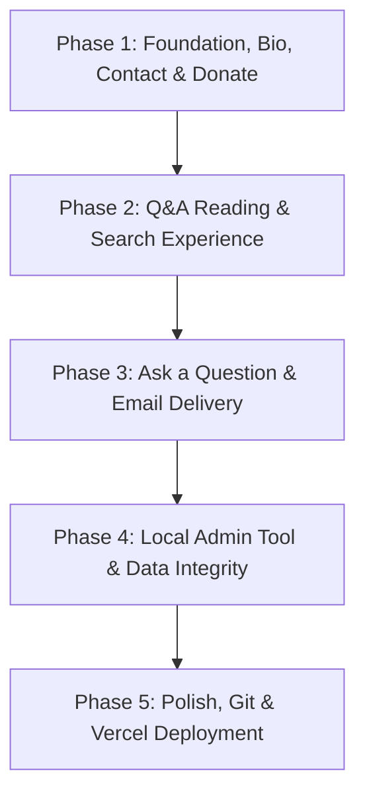
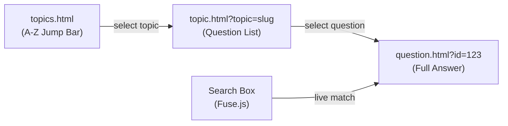
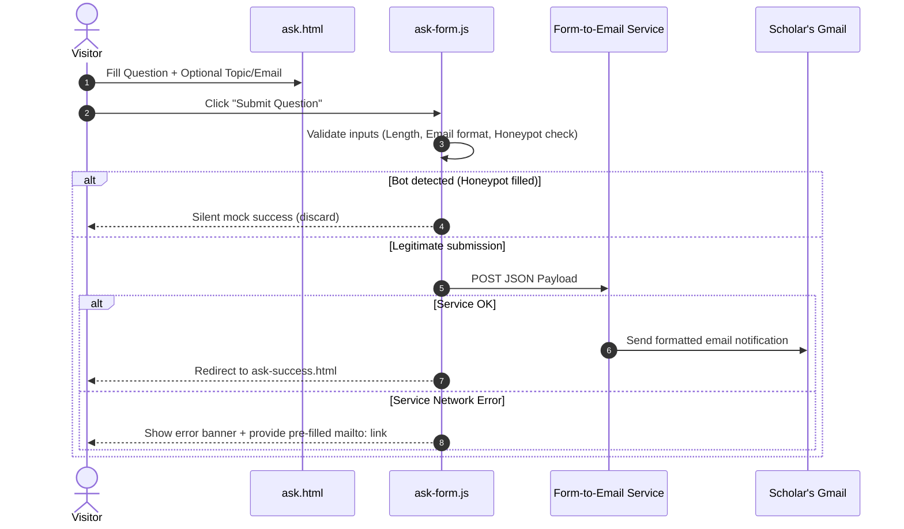
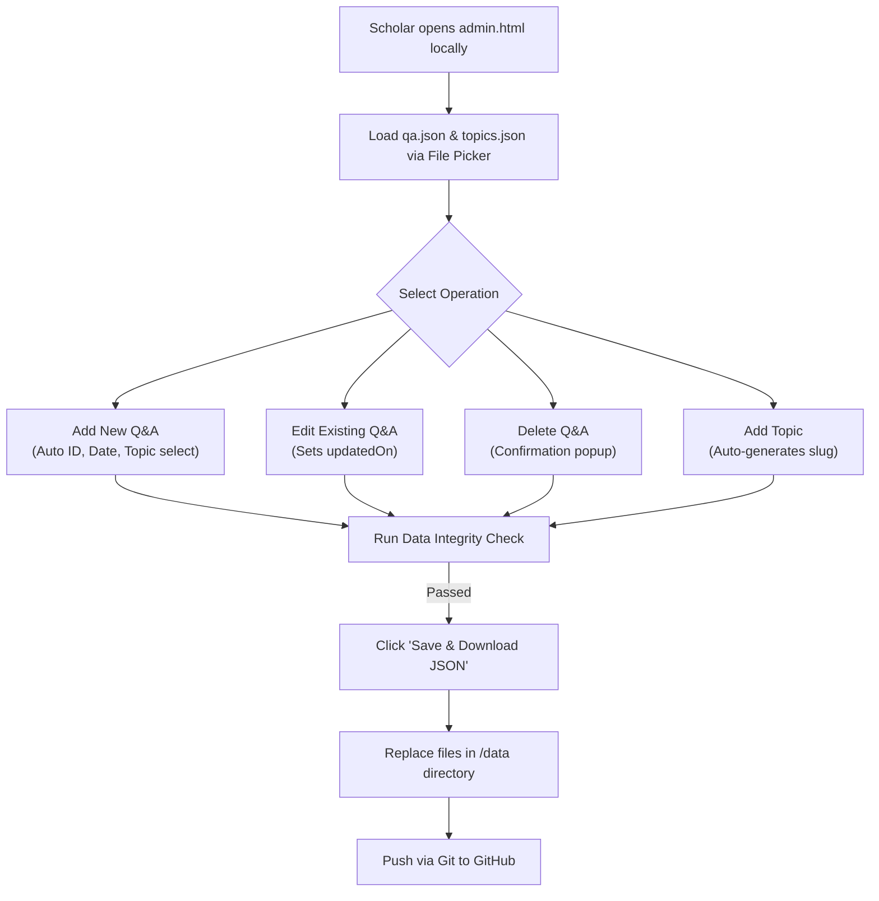
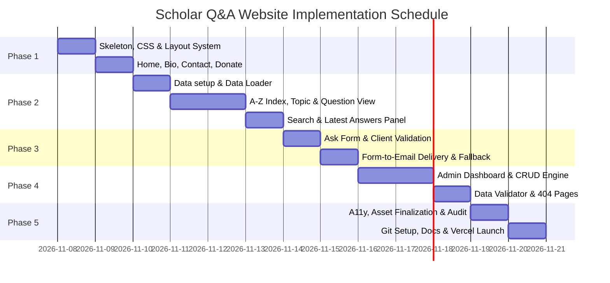

# Scholar Q&A Website — Phase-Wise Implementation Plan

**Date:** November 7, 2026  
**Document Version:** 1.0  
**References:** 
- [Problem Statement](./Scholar-QA-Website-Problem-Statement.md)
- [Architecture Document](./architecture.md)

---

## 1. Executive Summary & Strategy

This document details the step-by-step, vertical-slice implementation plan for building the static Q&A website for **Ayatullah Syed Sibtain Abbas Rizvi**.

### Core Execution Tenets
1. **Vertical Slicing:** Build and verify complete, end-to-end functionality for each slice before proceeding to the next.
2. **Zero-Backend & Static Simplicity:** Plain HTML, modular CSS, vanilla JavaScript, and flat JSON files. No build tooling or framework overhead.
3. **Strict Content Integrity:** No AI generation, summarization, or extrapolation of religious rulings or scholar facts. Placeholder data must be explicitly flagged and purged before production release.
4. **Mobile-First Verification:** Every phase verifies mobile screen stability down to 360px viewport width with zero horizontal scrolling.
5. **Scholar-Empowered Workflow:** Publishing and management workflows must be operable by a non-technical user in under 10 minutes using documented plain-language steps.

---

## 2. Requirement Traceability Matrix (FR & Phase Mapping)

| Requirement | Description | Target Phase | Primary Artifact(s) |
|---|---|---|---|
| **FR-1** | Consistent Shared Navigation Header & Footer | Phase 1 | `js/nav.js`, `css/layout.css` |
| **FR-2** | Mobile-First Responsiveness (≥ 360px) | Phase 1–5 | `css/responsive.css` |
| **FR-3** | A-Z Topic Index with Counts & Jump Bar | Phase 2 | `topics.html`, `js/topics-index.js` |
| **FR-4** | Permanent Links for Questions (`?id=123`) | Phase 2 | `question.html`, `js/question-page.js` |
| **FR-5** | Instant Client-Side Fuzzy Search | Phase 2 | `js/search.js`, Fuse.js integration |
| **FR-6** | Ask Question Form with Validation | Phase 3 | `ask.html`, `js/ask-form.js` |
| **FR-7** | Spam-Protected Form-to-Gmail Delivery | Phase 3 | Web3Forms/Formspree + Honeypot |
| **FR-8** | Data-Driven Pages from Flat JSON Files | Phase 1 & 2 | `js/data-loader.js`, `data/*.json` |
| **FR-9** | Offline-Capable Local Admin Helper | Phase 4 | `admin.html`, `js/admin.js` |
| **FR-10** | Content Integrity & Schema Validation | Phase 4 | `validate.html`, `admin.js` |
| **FR-11** | Latest Answers Side Panel on Home Page | Phase 2 | `index.html`, `js/latest-answers.js` |
| **FR-12** | Safe Edit & Delete with Tombstones/404 | Phase 4 | `admin.js`, `404.html` |
| **FR-13** | Contact Page with Tap-to-Call/Email | Phase 1 | `contact.html`, `js/contact.js` |
| **FR-14** | Display-Only Donation Page (QR + Copy) | Phase 1 | `donate.html`, `js/donate.js` |
| **FR-15** | GitHub Versioning & Vercel Auto-Deploy | Phase 5 | `vercel.json`, `README.md`, GitHub CI |

---

## 3. Phase Breakdown & Vertical Slices

---

### Phase 1: Foundation, Biography, Contact, and Donation

**Goal:** Establish project skeleton, core typography, shared navigation system, design tokens, and deliver the static information pages (Home, Biography, Contact, and Donation).

#### Slice 1.1: Project Skeleton & Shared Design Tokens
- [x] Create repository directory tree (`css/`, `js/`, `data/`, `assets/images/`, `assets/fonts/`).
- [x] Create `css/variables.css`: Design tokens (Islamic green `#1B5E20`, gold accent `#C8A951`, warm neutrals `#FAFAF5`, spacing scales, typography).
- [x] Create `css/reset.css` and `css/layout.css`: Semantic HTML containers, flex/grid layouts.
- [x] Create `css/components.css`: Button styles, card primitives, copy pills, alerts, badges.
- [x] Create `css/responsive.css`: Breakpoints for mobile (≤599px), tablet (600px–1023px), and desktop (≥1024px).
- [x] Create `js/utils.js`: URL parameter helpers, date formatting, HTML escaping functions (`escapeHTML`), copy-to-clipboard helper.

#### Slice 1.2: Shared Navigation & Layout Engine
- [x] Create `js/nav.js`:
  - Dynamically inject identical header and navigation bar into `#site-header`.
  - Links: Home, Biography, Q&A, Ask Question, Contact, Donate.
  - Active page indicator based on `window.location.pathname`.
  - Mobile hamburger menu toggle with accessible ARIA tags (`aria-expanded`).
  - Inject consistent footer into `#site-footer` with copyright, scholar name, and contact summary.

#### Slice 1.3: Data Layer Initializer (`data/site.json`)
- [x] Create `data/site.json` schema:
  - `siteName`, `tagline`
  - `contact`: phone, email, whatsapp, addresses, hours, social links.
  - `donation`: note, qrImage, bankDetails (accountHolder, bankName, accountNumber, branch, ifsc).
- [x] Create `js/data-loader.js`: Fetch utility with in-memory caching for `site.json`, `qa.json`, and `topics.json`.

#### Slice 1.4: Home Page (`index.html`) Base
- [x] Create `index.html` structure:
  - Hero section introducing Ayatullah Syed Sibtain Abbas Rizvi.
  - Scholar portrait image container (with responsive fallback).
  - Quick action CTA links: "Browse Q&A", "Ask a Question", "Contact".
  - Placeholder mount element `#latest-answers-panel` (reserved for Phase 2).

#### Slice 1.5: Biography Page (`biography.html`)
- [x] Create `biography.html` strictly restricted to Section 4 supplied facts:
  - Early Life & Studies in India (Anwarul Uloom, Allahabad under Syed Allama Jawadi & Syed Ahsan Abbas Rizvi).
  - Studies in Qum (Under Ayatollah Taqi Bahjat, Ayatollah Hassan Hasanzadeh Amoli, and other scholars).
  - Attainment of Ijtihad.
  - Present Religious Service in Qum and India.
- [x] Ensure clear visual typography hierarchy using serif heading styling.

#### Slice 1.6: Contact Page (`contact.html` & `js/contact.js`)
- [x] Create `contact.html` and `js/contact.js`:
  - Render dynamically from `site.json`.
  - Phone link (`tel:`) configured for direct tap-to-call on smartphones.
  - Email link (`mailto:`) and WhatsApp direct chat link.
  - Physical office addresses (Qum / India) and reception hours.
  - Omit any missing/null attributes automatically without leaving empty containers.

#### Slice 1.7: Donation Page (`donate.html` & `js/donate.js`)
- [x] Create `donate.html` and `js/donate.js`:
  - Informational notice stating donations support educational/religious services.
  - QR Code image rendering with fallback text.
  - Clean bank details card: Account Holder Name, Bank Name, Account Number, Branch, IFSC Code.
  - "Copy" button beside account number and IFSC code using `navigator.clipboard`.
  - Prominent verification advisory: *"Please confirm the account holder name matches before completing transfers."*
  - **Zero collection:** No card inputs, forms, or payment gateway scripts.

#### Phase 1 Verification & Acceptance Criteria
- [x] Open in browser: Home, Biography, Contact, and Donate pages render cleanly.
- [x] Viewport test at 360px, 768px, and 1200px: Zero horizontal scroll; hamburger menu functions correctly.
- [x] Tap-to-call and tap-to-copy work on mobile/desktop browsers.
- [x] `site.json` edits immediately reflect in Contact and Donation pages upon page reload.

---

### Phase 2: Q&A Reading Experience & Search

**Goal:** Deliver the core value of the site: A-Z topic index, topic browsing, single Q&A pages with permanent links, live client-side search, and the home page "Latest Answers" panel.

#### Slice 2.1: Data Sets Preparation
- [x] Create `data/topics.json` with 10–15 standard Islamic jurisprudence topics (e.g., Prayer, Fasting, Purity, Hajj, Zakat, Marriage, Business).
- [x] Create `data/qa.json` containing 8–10 structured placeholder Q&A items, labeled with `[SAMPLE PLACEHOLDER]`. Ensure strict schema compliance (`id`, `topic`, `question`, `answer`, `answeredOn`, `language`, `updatedOn`).

#### Slice 2.2: Topics Index Page (`topics.html` & `js/topics-index.js`)
- [x] Build sticky A-Z jump bar (`#jump-bar`) across the top of `topics.html`.
- [x] Generate A-Z letter blocks grouping topics alphabetically.
- [x] Compute real-time question counts per topic dynamically from `qa.json`.
- [x] Dim letters that have no associated topics (non-clickable, lower opacity).
- [x] Link each topic card directly to `topic.html?topic={slug}`.

#### Slice 2.3: Single Topic Page (`topic.html` & `js/topic-page.js`)
- [x] Parse `?topic={slug}` using `utils.js`.
- [x] Display topic title, breadcrumbs (`Home > Q&A > Topic Name`), and total answer count.
- [x] List all questions under the chosen topic, ordered newest first by `answeredOn`.
- [x] Each question card displays: Question title, answered date, preview excerpt, and "Read Answer" link to `question.html?id={id}`.
- [x] Provide graceful error UI if `topic` parameter is missing or invalid.

#### Slice 2.4: Single Question Page (`question.html` & `js/question-page.js`)
- [x] Parse `?id={number}` from query string.
- [x] Locate entry in `qa.json`:
  - Render full question text with high-contrast typography.
  - Render full answer with formatted paragraph breaks.
  - Display metadata bar: Associated Topic (linked), Date Answered (`answeredOn`), and Last Updated date (`updatedOn` if present).
  - "Share / Copy Link" button using `window.location.href`.
  - "Back to {Topic Name}" breadcrumb link.
- [x] Not Found / Deleted State: If ID does not exist in `qa.json`, render friendly tombstone:
  *"This answer is no longer available or the link may be incorrect. Browse our topic index."*

#### Slice 2.5: Client-Side Live Search (`js/search.js`)
- [x] Integrate Fuse.js via CDN (or local vendor copy in `js/vendor/fuse.min.js`).
- [x] Configure multi-key search weights:
  - `question`: weight 0.40
  - `answer`: weight 0.35
  - `topic`: weight 0.25
- [x] Embed search input on `topics.html` and `topic.html`.
- [x] Debounce user keystrokes (250ms).
- [x] Live result rendering with highlighted matches and excerpt snippets.
- [x] Clear empty state: *"No answers match your search. Try different keywords or submit a new question."*
- [x] Esc key clears search; backspace restores default topic list view.

#### Slice 2.6: Home Page "Latest Answers" Side Panel (`js/latest-answers.js`)
- [x] Mount `#latest-answers-panel` on `index.html`.
- [x] Slice the 5 newest entries from `qa.json` (sorted descending by `answeredOn` / `id`).
- [x] Badge logic: Display "New" badge for questions answered within the past 7 days (`utils.isRecent`).
- [x] Responsive layout: Desktop displays as a dedicated sticky side column; mobile stacks smoothly beneath the hero section.
- [x] Include "View All Questions →" link pointing to `topics.html`.

#### Phase 2 Verification & Acceptance Criteria
- [x] Navigate from `topics.html` → Jump bar letter click → Topic selection → Question view in ≤ 3 clicks/taps.
- [x] Deep linking to `question.html?id={valid_id}` loads exact question; invalid ID displays friendly fallback.
- [x] Live search finds terms within answers, questions, or topic names with response time under 100ms.
- [x] Home page side panel displays the 5 newest answers and updates automatically when `qa.json` is modified.

---

### Phase 3: Send a Question (Form & Email Delivery)

**Goal:** Enable visitors to submit religious questions without authentication, validate inputs, block spam bots, and deliver submissions directly to the scholar's Gmail with a graceful mailto fallback.

#### Slice 3.1: Question Submission Page (`ask.html`)
- [x] Build clean, focused form UI:
  - Question text area (`<textarea name="question" required minlength="20">`).
  - Topic select dropdown (`<select name="topic">`) populated dynamically from `topics.json`, defaulting to "Not sure / General".
  - Optional Asker Name (`<input type="text" name="name">`).
  - Optional Asker Email (`<input type="email" name="email">`) with descriptive label: *"Optional. Only provided if you wish to receive a direct response."*
  - Plain-language privacy disclaimer: *"Questions may be answered publicly on this website. Your name and email will never be published."*

#### Slice 3.2: Anti-Spam & Client-Side Validation (`js/ask-form.js`)
- [x] Honeypot field implementation:
  - Invisible text field (`name="_gotcha"` / `name="_honeypot"`), positioned off-screen and hidden from screen readers (`tabindex="-1"`, `aria-hidden="true"`).
  - If field is populated upon submit, silently abort submission and redirect to success page without sending email.
- [x] Client validation checks:
  - Reject empty questions or submissions shorter than 20 characters.
  - Validate email syntax if entered.
  - Prevent duplicate submissions via button disable and "Submitting..." spinner state.

#### Slice 3.3: Form Service Integration & Mailto Fallback
- [x] Configure Web3Forms or Formspree integration with configurable access key in `js/ask-form.js`.
- [x] Pre-format email payload:
  - Email Subject: `[Scholar Q&A] New Question: {Topic}`
  - Email Body: Question text, Selected topic, Asker name, Asker email, Submission timestamp.
- [x] Fallback mechanism:
  - If API POST fails or times out (5 seconds), display an inline alert box with a generated `mailto:` button pre-filling the scholar's email, subject, and question text.
  - Provide a permanent secondary text link: *"Prefer sending via your email app? Click here to email directly."*

#### Slice 3.4: Confirmation Page (`ask-success.html`)
- [x] Design reassuring, polite confirmation page:
  - Reassurance that question was submitted to the scholar's inbox.
  - Realistic expectations notice: *"Due to volume, not every question can receive an individual response or immediate publication."*
  - Links: "Back to Home", "Browse existing questions".

#### Phase 3 Verification & Acceptance Criteria
- [x] Submit valid question from mobile device → verify formatted email arrives in scholar's Gmail in < 60 seconds.
- [x] Fill honeypot field manually in developer tools → verify form claims success but zero emails arrive.
- [x] Disconnect network and submit → verify error state appears with functional pre-filled `mailto:` link.

---

### Phase 4: Publishing Workflow & Data Integrity

**Goal:** Provide the scholar with an offline, local administrative tool (`admin.html`) to add, edit, and delete answers, validate JSON schemas, and ensure zero duplicate IDs or orphaned topics.

#### Slice 4.1: Local Admin Dashboard Shell (`admin.html` & `css/admin.css`)
- [x] Build offline-first, single-page application at `admin.html`.
- [x] File Loader Section:
  - Two file input pickers to load `data/qa.json` and `data/topics.json`.
  - Read files using browser `FileReader` API into in-memory state.
  - Status indicator: "Files Loaded: X questions, Y topics".
- [x] Quick Search & Filter bar to browse through existing answers by topic or search keyword.

#### Slice 4.2: Add, Edit, and Delete Workflows (`js/admin.js`)
- [x] **Add Operation:**
  - Form fields: Topic (dropdown populated from loaded `topics.json`), Question (textarea), Answer (textarea).
  - Automatic ID generator: Computes `Math.max(...existingIds) + 1`. Never reuses deleted IDs.
  - Auto-sets `answeredOn` to today's date (`YYYY-MM-DD`).
- [x] **Edit Operation:**
  - Loads selected question into editor.
  - Keeps original `id` and `answeredOn` intact.
  - Automatically updates `updatedOn` to today's date.
- [x] **Delete Operation:**
  - Triggered with explicit confirmation dialog showing the question text.
  - Removes entry from the in-memory array.

#### Slice 4.3: Topic Manager
- [x] Add Topic modal/section:
  - Input: Display Name (e.g., "Inheritance & Wills").
  - Auto-slug generator: Converts to lowercase URL-safe slug (e.g., `inheritance-and-wills`).
  - Verifies slug uniqueness against loaded `topics.json`.

#### Slice 4.4: Data Integrity Validator (`validate.html` & embedded in `admin.js`)
- [x] Create rigorous schema validation engine:
  - Verifies every `topic` in `qa.json` matches a valid `slug` in `topics.json`.
  - Asserts all `id` values are positive, unique integers.
  - Asserts all dates match `YYYY-MM-DD` regex format.
  - Asserts no empty question or answer strings exist.
  - Confirms `site.json` has required contact phone and donation bank details.
- [x] Build standalone `validate.html` page to allow independent pre-deploy verification.

#### Slice 4.5: Safe File Export & Publishing Instructions
- [x] Export mechanism:
  - Generates downloadable Blobs for `qa.json` and `topics.json`.
  - Formatted with 2-space JSON indentation for clean Git diffs.
- [x] Embedded "How to Publish" modal/tab in `admin.html` with plain-language steps:
  1. Click "Download Updated Data".
  2. Move downloaded files into the `data/` folder.
  3. Run git commands: `git add .`, `git commit -m "Updated answers"`, `git push`.

#### Slice 4.6: 404 & Tombstone Handling (`404.html`)
- [x] Create standalone `404.html` maintaining the site's header/footer branding.
- [x] Explains clearly whether a page is missing or an answer was archived/deleted.
- [x] Search input and quick links back to A-Z Topic Index.

#### Phase 4 Verification & Acceptance Criteria
- [x] Load sample files into `admin.html` → Add 1 question, edit 1 question, delete 1 question.
- [x] Download updated files → run `validate.html` → passes with zero errors.
- [x] Verified that ID numbers never collide or reuse deleted numbers.
- [x] A deleted question URL (`question.html?id={deleted}`) displays a polite tombstone state.

---

### Phase 5: Polish, Accessibility, Git & Vercel Deployment

**Goal:** Perform cross-browser audits, accessibility tuning, documentation completion, purge placeholders with real scholar data, push to GitHub, and launch on Vercel.

#### Slice 5.1: Accessibility (a11y) & SEO Polish
- [x] Semantic HTML review: Proper nesting of `<h1>` through `<h3>`, landmarks (`<nav>`, `<main>`, `<aside>`, `<footer>`).
- [x] Screen reader testing: Form labels connected via `for`/`id`, ARIA live region on live search results.
- [x] Keyboard navigation: Visible `:focus-visible` styling on all buttons, links, and inputs.
- [x] WCAG AA color contrast check: Ensure all text colors against `#FAFAF5` and `#1B5E20` meet 4.5:1 ratio.
- [x] Meta tags: Unique `<title>` and `<meta name="description">` per page. OpenGraph tags for social sharing.
- [x] Favicon assets generation and installation in `assets/images/favicon.svg`.

#### Slice 5.2: Production Data Verification & Placeholder Purge
- [x] Scholar inputs audit against Section 11 of Problem Statement:
  - [x] Professional portrait photo placed in `assets/images/scholar-photo.jpg`.
  - [x] Scholar bio confirmed against supplied facts.
  - [x] Donation QR code image placed in `assets/images/qr-code.png`.
  - [x] Bank account details verified against scholar-provided document.
  - [x] Form submission email confirmed with scholar.
- [x] Replace all `[SAMPLE PLACEHOLDER]` entries in `qa.json` with 5–10 approved starter questions.
- [x] Re-run `validate.html` against production data.

#### Slice 5.3: Repository Setup & Documentation
- [x] Initialize Git repository.
- [x] Create `.gitignore` (ignoring OS files, `.DS_Store`, editor settings, temporary downloads).
- [x] Create `vercel.json` with routing rules, clean URLs, and caching headers for `/data/` (5 mins) and `/assets/` (immutable).
- [x] Author comprehensive `README.md`:
  - Project purpose & technology stack summary.
  - Folder layout guide.
  - How to run locally (Python HTTP / Live Server).
  - Step-by-step guide for the scholar: Adding an answer, editing, deleting, updating contact/bank info.
  - How deployments work automatically via GitHub → Vercel.

#### Slice 5.4: Deployment to Vercel
- [x] Connect GitHub repository to Vercel (Hobby plan, free tier).
- [x] Set Framework Preset to "Other" (static deployment, no build command, output root `.`).
- [x] Verify live domain SSL provisioning (`https://{project-name}.vercel.app`).
- [x] Perform live smoke test across phone and desktop:
  - Check Home, Bio, Topics, Single Question, Search, Ask Form, Contact, Donate.
  - Submit live test question → confirm Gmail delivery.
  - Verify donation bank details and copy button on mobile device.

#### Phase 5 Verification & Acceptance Criteria
- [x] Google Lighthouse Audit scores: Performance > 95, Accessibility > 95, Best Practices > 95, SEO > 95.
- [x] Git commit and push to `main` branch triggers automatic Vercel build and updates live site within 2 minutes.
- [x] Zero placeholder strings exist in the deployed repository.

---

## 4. Scholar Onboarding & Asset Delivery Checklist

Before final deployment in Phase 5, the following real-world assets and inputs must be provided by the scholar:

| Item | Description | Status | Target Location |
|---|---|---|---|
| **Scholar Portrait** | High-res photo (min 800px wide) | Pending | `assets/images/scholar-photo.jpg` |
| **Biography Approval** | Review of facts in Section 4 (honorifics, dates, teachers) | Pending | `biography.html` |
| **Initial Topics** | 10–20 preferred topic names (spelled as desired) | Pending | `data/topics.json` |
| **Starter Q&As** | 5–10 approved real question/answer pairs | Pending | `data/qa.json` |
| **Gmail Address** | Scholar's inbox to receive incoming submissions | Pending | Form service config |
| **Contact Info** | Official phone number, WhatsApp, addresses, hours | Pending | `data/site.json` |
| **Donation QR Code** | High-contrast QR image file | Pending | `assets/images/qr-code.png` |
| **Bank Account Data** | Account name, bank name, account number, branch, IFSC | Pending | `data/site.json` |
| **Donation Note** | Short explanatory sentence for donors | Pending | `data/site.json` |
| **Accounts** | Free GitHub and Vercel accounts | Pending | CI/CD setup |

---

## 5. Risk Assessment & Mitigation Matrix

| Risk Event | Severity | Probability | Mitigation Strategy |
|---|---|---|---|
| **Accidental AI Answer Generation** | Critical | Low | Hard rule in guidelines: Agent strictly forbidden from writing rulings. All answers must be scholar-supplied. |
| **Form Service Outage or Limit Exceeded** | High | Low | Free tier handles 250 submissions/month. Inline `mailto:` fallback allows direct emailing if API fails. |
| **Scholar Overwrites JSON Improperly** | High | Medium | `admin.html` validates data before export. Git history allows one-click rollback of any commit. |
| **Search Performance Degradation** | Low | Low | Q&A dataset is small (<500 items). Fuse.js in-browser memory index executes in <50ms. |
| **Spam Inundation in Gmail** | Medium | Medium | Hidden CSS honeypot filters automated bots; free-tier captcha enabled on form endpoint. |
| **Broken Deep Links upon Edits** | Medium | Low | URLs anchor strictly on unchanging numeric IDs (`?id=123`). Question title changes do not alter URLs. |

---

## 6. Execution Timeline & Next Steps

### Immediate Next Action:
Begin **Phase 1, Slice 1.1**: Initialize the project directory structure, base design system (`css/variables.css`, `css/reset.css`, `css/layout.css`, `css/components.css`), and shared utilities (`js/utils.js`).

